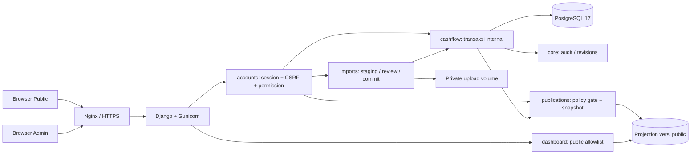

# Arsitektur Dashboard Cashflow EKU

Baseline desain M0, 21 Oktober 2026 WITA. Diagram menjelaskan batas arsitektur yang harus dipertahankan; status implementasi dan pengujian dibuktikan terpisah.

## Pilihan stack dan batas modul

Django 5.2 LTS, Python 3.12, PostgreSQL 17, template server-rendered, HTMX, Tailwind CSS dan ECharts. Gunicorn melayani aplikasi di belakang Nginx untuk staging/production. Static assets dilayani WhiteNoise/Nginx sesuai konfigurasi; workbook tidak pernah berada di static/public media. Tidak ada ketergantungan penyedia cloud. Aplikasi berjalan sebagai satu modular monolith agar transaksi import, audit dan publikasi memiliki batas commit PostgreSQL yang jelas.

| Modul | Tanggung jawab |
| --- | --- |
| accounts | Custom user, username/email login, Django Groups/permissions, permission editor, bootstrap admin |
| core | Master bank/wilayah/pecahan, settings/feature flags, audit append-only, validasi bersama |
| cashflow | Transaksi Decimal/UUID, revision, layanan CRUD/soft delete/restore/bulk, agregasi internal |
| imports | Upload privat, adapter sheet, staging/quality report, rekonsiliasi, verifikasi, preview/commit snapshot |
| publications | Snapshot immutable, projection allowlist, approval gate, atomic current pointer, rollback |
| dashboard | Public/Admin views, analytics, filter, chart DTO, export scoped |
| estimates | Kontrak adapter estimasi, model/domain dan empty state; tanpa forecasting aktif |

`masterdata` dan `audit` dikonsolidasikan dalam `core`; `verification` dalam `imports`. Ini pembagian modul, bukan penghapusan entitas atau kontrol. Hanya Django auth/groups dipakai untuk RBAC; tidak ada tabel role/permission kedua yang berbeda sumber kebenaran.

Jalur public hanya membaca pointer dan projection publikasi. Ia tidak memilih ORM transaksi berdasarkan parameter browser. Data publik tidak menyertakan bank, rekening, UUID transaksi, raw rows, file path atau audit. Projection awal hanya tanggal dan wilayah: filter publik pecahan/jenis uang belum menghasilkan rincian sampai kebijakan granularitas disetujui. Informasi kosong/pending lebih baik daripada menginferensi data internal.

## Alur import dan rekonsiliasi

1. Periksa permission, ukuran, ekstensi/konten XLSX, entri ZIP dan batas dekompresi. Tolak macro/external payload; tidak menjalankan formula. Nama file disimpan sebagai metadata yang disanitasi, path penyimpanan memakai identifier aplikasi.
2. Hitung SHA-256 sebelum parsing; buat batch/lock scoped agar dua upload identik tidak membuat transaksi ganda. Rekam lingkungan dan sumber dummy bila berlaku.
3. Adapter MANADO/KASTIP membaca seluruh baris aktual, bukan area autofilter. Adapter DENOM menyediakan mapping kandidat yang divalidasi. Tanggal serial mengikuti epoch workbook. Decimal membaca nilai ilmiah/integer secara exact. Identifiers string mempertahankan nol awal.
4. Stage raw dan normalisasi dengan `(batch, sheet, row)` unik. Simpan formula metadata/cached values terpisah, keputusan sign, konflik dan evidence. Full rekening hanya boleh berada dalam penyimpanan internal restricted; log/report umum disensor.
5. Fingerprint non-unique mencari kandidat. Checksum identik merupakan bukti file identik; signature serupa hanya bukti kemiripan. Rekonsiliasi multiset memperhitungkan banyaknya occurrence dalam scope snapshot yang telah dikonfirmasi, termasuk record soft-deleted. Identitas sumber yang tidak pasti tetap review.
6. Status `NEW_VALID` commit, `ALREADY_IMPORTED` skip, `NEEDS_REVIEW` antre, `INVALID` tertahan. Tidak ada `UNIQUE(fingerprint)` dan tidak ada auto-restore. Partial success dibedakan dari kegagalan keseluruhan.
7. Keputusan berizin harus mempunyai alasan; UPDATE memilih UUID target. Replace periode memerlukan deklarasi sumber lengkap, scope tanggal/wilayah eksplisit dan diff sebelum/sesudah; record yang hilang hanya dinonaktifkan dalam scope yang dikonfirmasi.
8. Commit memakai `transaction.atomic` dan row lock pada unit konsistensi. Audit/revision berada dalam transaksi perubahan. Kegagalan tidak mengubah public pointer. Pemrosesan sinkron berbatas dipilih dahulu; queue worker dapat ditambahkan tanpa mengubah kontrak staging/commit.

## Domain uang dan analitik

Rupiah disimpan sebagai `DecimalField(max_digits=20, decimal_places=0)`. Inflow dan outflow domain adalah magnitudo nonnegatif; arus bertentangan/dua arah dalam satu record ditolak atau ditahan. Netflow hanya derived `inflow - outflow`. Nominal sumber, sign sumber, pieces dan pecahan disimpan/ditelusuri tanpa diam-diam mengoreksi konflik. Domain tidak menghitung pecahan resmi dengan membagi amount/pieces.

Agregasi internal hanya transaksi valid aktif; public hanya versi aktif. Statistik count menghitung transaksi, bukan baris staging. MoM/YoY memakai periode pembanding setara dan menyatakan `N/A` jika baseline nol/tidak tersedia. Tidak adanya observasi tidak otomatis berarti nol. Kelengkapan periode memerlukan bukti sumber, bukan tanggal maksimum file. Seasonality hanya deskriptif beserta jumlah observasi.

## Publikasi, cache dan ekspor

Default `MANUAL`; publication approval reference kosong menutup publikasi operasional. Seed sintetis hanya di development/staging dan setiap halaman/ekspor demo berlabel `DATA DUMMY`. Mengaktifkan `AUTOMATIC` tidak melewati approval gate.

Service publikasi mengunci settings/current pointer, memvalidasi policy dan eligible data, menulis versi dan agregat baru, menghitung metadata/checksum, lalu mengganti pointer atomik. Versi lama tidak diedit. Rollback hanya menunjuk snapshot lama, tidak mengubah transaksi internal. Cache public harus memasukkan UUID versi; private responses memakai `Cache-Control: no-store`. CSV/Excel/PDF mengambil data dari service scope yang sama dengan layar dan menetralkan formula injection pada teks.

## Autentikasi, data privat dan deployment

SUPER_ADMIN dan ADMIN_STAFF adalah dua group awal. Permission individual `import_data`, `add_transaction`, `edit_transaction`, `verify_ambiguous`, `publish_manual`, `soft_delete`, `restore`, `bulk_soft_delete`, `bulk_restore`, `export_internal` diperiksa service/view server, bukan hanya template. Form mutasi menggunakan POST+CSRF, login dibatasi, security-sensitive actions diaudit. Integrasi MFA/SSO belum aktif.

Timezone penyimpanan UTC-aware; presentasi Asia/Makassar dan angka id-ID. Staging/production mensyaratkan `DEBUG=False`, secret kuat dari environment, allowed hosts/CSRF origin eksplisit, secure cookie dan HTTPS di edge. Database dan upload privat tidak dibuka ke internet. Docker/CI membangun environment Python3.12; Python sistem host 3.9.6 tidak memenuhi target. Docker belum tersedia pada host audit sehingga konfigurasi tidak boleh dilaporkan telah berhasil dijalankan sebelum smoke test nyata.

## Performa dan evolusi

Index tanggal/wilayah/bank/status deletion dan FK publication version; gunakan server-side pagination serta `select_related`/prefetch pada daftar. Filter public query terhadap projection jauh lebih kecil daripada raw transaksi. Batas upload dan page size eksplisit. Uji query count/performance basic menggunakan fixture; resource sizing produksi menunggu volume dan spesifikasi server. Tidak ada migrasi otomatis data legacy yang klasifikasi/otorisasinya belum diketahui.
