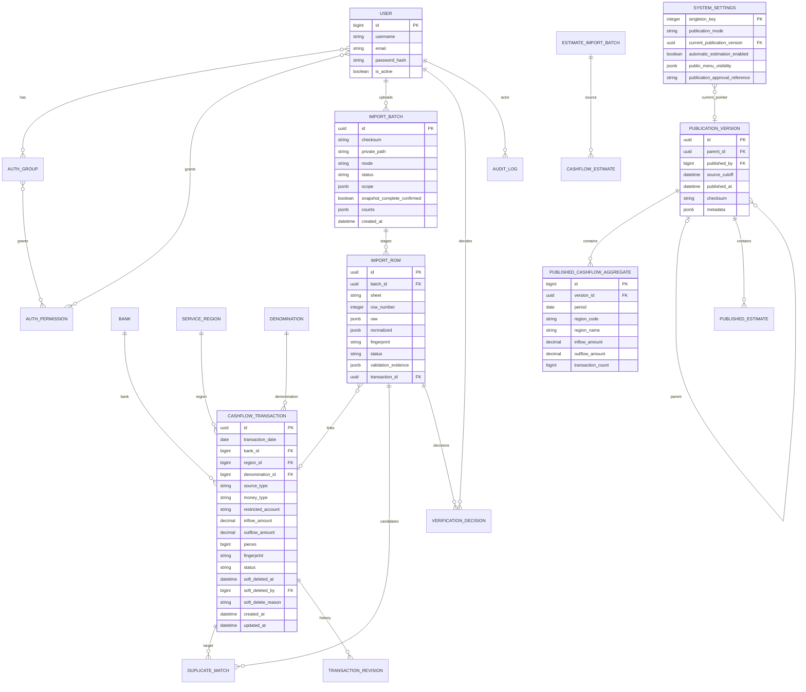

# ERD dan kontrak integritas

ERD logis M0. Nama tabel fisik mengikuti migrations Django; diagram tidak mengklaim tabel sudah dibuat. App `core` menyatukan master data/settings/audit; `imports` menyatukan staging dan verifikasi.

## Constraints dan index

| Entitas | Integritas wajib | Index/keamanan |
| --- | --- | --- |
| User/auth | Custom user ditetapkan sebelum migration awal; username unik; password hash Django | Permission native Django; dua group awal saja |
| Bank/region/denomination | Kode string; FK nyata; pecahan nominal positif; aliases eksplisit | Kode/master lookup; protect referenced master dari hard delete |
| Cashflow transaction | UUID PK; Decimal(20,0); inflow/outflow ≥0; pieces integral nonnegatif; netflow derived; status valid terpisah deletion | date, region/date, bank/date, status/deletion, fingerprint nonunique |
| Import batch | UUID; checksum file; scope/mode/status/counts; path privat; uploader/time | checksum + scope/status untuk idempotensi dan penguncian |
| Import row | UNIQUE(batch,sheet,row_number); raw/normalized JSONB; optional FK target | batch/status, fingerprint; raw tidak diekspos public |
| Duplicate match | FK row + candidate transaction + evidence, bukan keputusan otomatis | row/candidate; nilai score tidak disajikan sebagai kepastian identitas |
| Verification decision | FK row/user/target; alasan; action; timestamp; UPDATE wajib target | row/time; append-only |
| Transaction revision/audit | Before/after tersanitasi; actor/action/time/reason | object/time; append-only; no password/token/full rekening |
| Publication version | UUID; cutoff, actor, parent, checksum; immutable setelah dibentuk | published_at; versi tidak diubah untuk rollback |
| Published aggregate | Versi + tanggal + nama/kode wilayah disalin dalam snapshot; nominal nonnegatif; count nonnegatif | version/date/region_code; projection tanpa identitas bank/rekening; tidak bergantung pada perubahan master wilayah |
| System settings | Singleton; MANUAL default; OFF automatic estimation; current FK nullable | Atomic row lock saat publication/rollback; setiap perubahan diaudit |
| Estimate batch/estimate | Schema version/source/period/scope/status; belum terkonfigurasi tanpa input asli | Tidak menghasilkan/menampilkan angka jika schema/method belum tersedia |

Rekening sumber adalah string restricted, bukan numeric dan bukan bagian projection. Bila file numeric telah kehilangan nol awal, parser tidak menebak padding: data harus ditinjau. Raw provenance tersimpan privat sesuai kebutuhan audit; ekspor kualitas/audit umum memakai masking.

## Batas transaksi database

- Commit import mengunci unit batch/reconciliation yang relevan, memeriksa status kembali, lalu membuat transaksi/revision/decision/audit atomik. Unique row occurrence mencegah staging ganda; fingerprint tidak unique karena transaksi sah bisa identik.
- Period replacement menyimpan preview dan before/after, lalu memeriksa ulang snapshot/scope saat konfirmasi. Deactivation selalu soft delete dan tidak boleh melewati scope.
- Publication membuat versi/agregat dan mengubah pointer dalam satu transaksi. Exception mengembalikan seluruh perubahan; snapshot aktif sebelumnya tetap bisa dibaca. Rollback cukup mengganti pointer dan audit.
- Migration forward/reverse diuji pada database terpisah dengan data sintetis. Jangan menjalankan reverse migration destruktif pada production tanpa backup serta rencana rollback yang disetujui.

Perubahan implementasi yang memecah/menggabungkan entitas wajib dicatat dalam decision log dan dijaga ekuivalensi kontrolnya. Migration nyata merupakan sumber schema fisik; diagram diperbarui apabila kontrak domain berubah.
